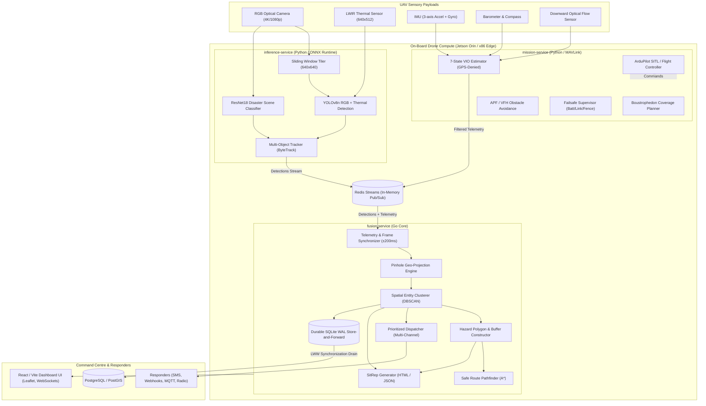

# System Architecture & Technical Algorithms: Khoj-o-Drone

Khoj-o-Drone (`sar-drone-prototype`) is an autonomous, on-edge search-and-rescue UAV perception, mapping, and mission orchestration platform developed for Smart India Hackathon 2026 (PS SIH26177, Team NIRIKSH).

The platform is designed to operate in fully network-denied, post-disaster environments (floods, earthquakes, fires, landslides) with zero reliance on cloud connectivity or active telemetry links.

---

## 1. High-Level System Architecture & Data Flow

---

## 2. Core Modules & Responsibilities

| Module | Runtime | Responsibility |
| :--- | :--- | :--- |
| **`inference-service`** | Python 3.11, ONNX Runtime | Video ingestion (RTSP/V4L2/MP4), 640x640 tiled windowing with 20% overlap, object detection (YOLOv8n for survivors and hazards), scene classification (ResNet18), and intra-modality ByteTrack tracking. Publishes to Redis Streams. |
| **`fusion-service`** | Go 1.22, pgxpool | High-throughput stream consumer. Correlates detections with drone attitude/altitude ($\pm 200\text{ms}$ window), performs ray-casting geo-projection, spatial DBSCAN clustering, hazard buffering, A* safe route calculation, prioritized alerting, and tile serving. |
| **`mission-service`** | Python 3.11, pymavlink | Autonomous flight control. Boustrophedon sweep planner for arbitrary search polygons, SITL/MAVLink coordinator, adaptive confirmation orbits, Vector Field Histogram obstacle avoidance, and 7-state EKF dead reckoning during GPS loss. |
| **`dashboard`** | React 19, TypeScript, Leaflet | Multi-pane responder command center. Live map with toggleable vector layers (survivors, hazards, safe routes, coverage heatmap, drone track), camera feeds with bounding box overlays, mission control, and offline store-and-forward status monitoring. |
| **`shared/`** | Schemas & Generated Stubs | Canonical Protobuf contracts and JSON Schemas validated across Python, Go, and TypeScript. |

---

## 3. Mathematical Algorithms & Implementation Details

### 3.1 Pinhole Geo-Projection Ray-Casting
To convert bounding box screen coordinates $(x_{\text{norm}}, y_{\text{norm}}) \in [0, 1]$ into real-world WGS-84 coordinates $(\text{Lat}, \text{Lon})$, the system models the downward gimbaled camera as a pinhole projective model intersecting the ground plane (or local elevation model).

#### Mathematical Formulation:
1. **Centroid Angles Relative to Optical Axis:**
   $$\theta_x = (x_{\text{norm}} - 0.5) \cdot \text{HFOV}$$
   $$\theta_y = -(y_{\text{norm}} - 0.5) \cdot \text{VFOV}$$

2. **Camera Frame Ground Displacement (Meters):**
   $$\Delta x_{\text{cam}} = h_{\text{AGL}} \cdot \tan(\theta_x)$$
   $$\Delta y_{\text{cam}} = h_{\text{AGL}} \cdot \tan(\theta_y)$$
   where $h_{\text{AGL}}$ is drone altitude above ground level.

3. **Rotation by Drone Heading ($\psi$):**
   $$\Delta N = \Delta y_{\text{cam}} \cos\psi - \Delta x_{\text{cam}} \sin\psi$$
   $$\Delta E = \Delta y_{\text{cam}} \sin\psi + \Delta x_{\text{cam}} \cos\psi$$

4. **WGS-84 Geodetic Offsets:**
   $$\Delta \text{Lat} = \frac{\Delta N}{M_{\text{lat}}}, \quad M_{\text{lat}} = 111{,}320\text{ m/deg}$$
   $$\Delta \text{Lon} = \frac{\Delta E}{M_{\text{lat}} \cdot \cos(\text{Lat}_{\text{drone}})}$$
   $$\text{Lat}_{\text{target}} = \text{Lat}_{\text{drone}} + \Delta \text{Lat}, \quad \text{Lon}_{\text{target}} = \text{Lon}_{\text{drone}} + \Delta \text{Lon}$$

#### Worked Numerical Example:
- **Drone State:** $\text{Lat} = 20.00000^\circ\text{N}, \text{Lon} = 78.00000^\circ\text{E}, h_{\text{AGL}} = 50.0\text{ m}, \psi = 90.0^\circ\text{ (Heading East)}$.
- **Camera Optics:** $\text{HFOV} = 90^\circ, \text{VFOV} = 60^\circ$.
- **Detection Centroid:** Centered horizontally ($x = 0.50$), lower third vertically ($y = 0.70$).
  $$\theta_x = (0.50 - 0.50) \cdot 90^\circ = 0.0^\circ \implies \Delta x_{\text{cam}} = 0.0\text{ m}$$
  $$\theta_y = -(0.70 - 0.50) \cdot 60^\circ = -12.0^\circ \implies \Delta y_{\text{cam}} = 50.0 \cdot \tan(-12^\circ) = -10.63\text{ m}$$
- **Heading Rotation ($\psi = 90^\circ$):**
  $$\Delta N = -10.63 \cdot \cos(90^\circ) - 0 = 0.0\text{ m}$$
  $$\Delta E = -10.63 \cdot \sin(90^\circ) + 0 = -10.63\text{ m (10.63m West)}$$
- **Geodetic Coordinate:**
  $$\Delta \text{Lon} = \frac{-10.63}{111{,}320 \cdot \cos(20^\circ)} = \frac{-10.63}{104{,}606} = -0.0001016^\circ$$
  $$\text{Target Position} = (20.00000^\circ\text{N}, 77.999898^\circ\text{E})$$

---

### 3.2 Multi-Modal Registration & Spatial Fusion
To cross-reference detections between RGB and LWIR thermal sensors with differing focal lengths and mounting offsets:
1. **Affine Homography Matrix ($H$):** A $3 \times 3$ projective matrix pre-calibrated via checkerboard thermal-visible targets maps thermal pixel coordinates to RGB coordinates:
   $$\begin{bmatrix} x_{\text{rgb}} \\ y_{\text{rgb}} \\ 1 \end{bmatrix} = \mathbf{H} \begin{bmatrix} x_{\text{thermal}} \\ y_{\text{thermal}} \\ 1 \end{bmatrix}$$
2. **Spatial-Temporal Intersection-over-Union (IoU):** Detections whose projected ground coordinates lie within $d_{\text{cluster}} \le 3.0\text{m}$ within a $\Delta t \le 1.0\text{s}$ window are merged into a single multi-modal entity with modality tags `["rgb", "thermal"]`.

---

### 3.3 Prioritized Dispatch Scoring Formula
Alert ranking is computed deterministically to eliminate responder cognitive overload:
$$P = \min\left(1.0, \; S_{\text{class}} \cdot C \cdot \left[1.0 + \sum_{h \in \text{Hazards}} \frac{W_h}{1.0 + \alpha \cdot d(s, h)}\right]\right)$$

- $S_{\text{class}}$: Class base severity ($1.0$ for `person`, $0.8$ for `fire`/`flood`, $0.6$ for `structural_damage`).
- $C$: Detection confidence score $\in [0, 1]$.
- $d(s, h)$: Euclidean ground distance in meters between survivor $s$ and hazard $h$.
- $\alpha$: Proximity decay factor ($\alpha = 0.05$).
- $W_h$: Hazard weight ($0.5$ for `fire`, $0.4$ for `flood`, $0.3$ for `structural_damage`).

Survivors marooned near active hazards receive higher priority scores ($\ge 0.70 = \text{Critical}$) and trigger automated sirens and webhook notifications.

---

### 3.4 Hazard Polygons & Buffer Zones
1. **Point Accumulation:** Raw hazard observations are grouped into spatial clusters via DBSCAN ($\epsilon = 30\text{m}, \text{MinPts} = 2$).
2. **Convex Hull / Alpha Shape:** For clusters with $\ge 3$ points, a 2D hull is constructed.
3. **Minkowski Sum Buffer Expansion:** Polygons are buffered by hazard-specific safety clearances:
   - `fire`: $+50\text{ m}$ buffer
   - `flood`: $+40\text{ m}$ buffer
   - `structural_damage`: $+30\text{ m}$ buffer
   - `power_line`: $+20\text{ m}$ buffer
4. **PostGIS Storage:** Persisted as `ST_MultiPolygon` with spatial index `GIST(geom)` for fast point-in-polygon and line intersection queries.

---

### 3.5 A* Safe Rescue Pathfinding
To guide ground search-and-rescue teams from a forward base to trapped survivors:
1. **Discretization:** The operational bounding box is discretized into an $N \times M$ cost grid (cell size $5\text{m} \times 5\text{m}$).
2. **Cost Assignment:**
   - Free space: Cost = $1.0$
   - Hazard buffer zone: Cost = $\infty$ (impassable obstacle)
   - Proximity proximity decay: Added cost within $1.5 \times$ buffer to prefer clear routes over narrow edges.
3. **8-Connected A* Search:** Evaluates $f(n) = g(n) + h(n)$ where $h(n)$ is Euclidean distance to the survivor destination.
4. **Path Pruning:** Ramer-Douglas-Peucker algorithm simplifies the waypoint sequence into actionable turn-by-turn vectors. If all routes are blocked, the algorithm halts safely and flags `no_safe_route = true`.

---

### 3.6 Coverage Path Planning (Boustrophedon Sweep)
For systematic search across irregular disaster polygons:
1. **Optimal Sweep Angle Calculation:** Computes the Minimum Area Oriented Bounding Box (OBB) of the polygon to align sweep swaths parallel to the longest edge, minimizing turnaround maneuvers.
2. **Track Spacing ($W_{\text{swath}}$):**
   $$W_{\text{swath}} = 2 \cdot h_{\text{AGL}} \cdot \tan\left(\frac{\text{HFOV}}{2}\right) \cdot (1.0 - \text{Overlap}_{\text{lateral}})$$
3. **Waypoint Generation:** Generates parallel scan lines intersected with the polygon boundary, connecting endpoints in alternating boustrophedon order.

---

### 3.7 Autonomous Store-and-Forward SQLite WAL Resilience
Under network partitions or upstream database failures:
1. **Dual-Tier Write-Ahead Buffer:** Outbound records (`queued_detections`, `queued_entities`, `queued_alerts`, `queued_outbound`) are durably written to a local SQLite database in WAL (Write-Ahead Logging) mode.
2. **Last-Write-Wins (LWW) Conflict Resolution:** Each entity update carries a monotonic sequence or timestamp. Drained updates resolve against PostGIS using `ON CONFLICT (id) DO UPDATE WHERE EXCLUDED.last_seen > entities.last_seen`.
3. **Exponential Backoff:** Upstream health check probes every $T_{\text{probe}} = \min(30\text{s}, 1.0\text{s} \cdot 2^k)$. On connection restoration, the background drain loop pushes batches with zero data loss ($0$ lost detections).

---

### 3.8 Visual-Inertial Odometry (7-State Extended Kalman Filter)
During GPS blackout windows (canyons, indoor collapse, electromagnetic jamming), a 7-state EKF estimates drone position and velocity:

$$\mathbf{x} = [p_x, p_y, p_z, v_x, v_y, v_z, \psi]^T$$

1. **Prediction Step (IMU Driven):**
   $$\mathbf{p}_{k} = \mathbf{p}_{k-1} + \mathbf{v}_{k-1} \Delta t + \frac{1}{2} \mathbf{R}(\psi_{k-1}) \mathbf{a}_{\text{imu}} \Delta t^2$$
   $$\mathbf{v}_{k} = \mathbf{v}_{k-1} + \mathbf{R}(\psi_{k-1}) \mathbf{a}_{\text{imu}} \Delta t$$
   $$\psi_{k} = \psi_{k-1} + \omega_z \Delta t$$
2. **Measurement Update (Downward Optical Flow):**
   $$z_{\text{flow}, x} = \frac{v_x}{h_{\text{AGL}}} \cdot f_{\text{lens}} \cdot \Delta t$$
   $$z_{\text{flow}, y} = \frac{v_y}{h_{\text{AGL}}} \cdot f_{\text{lens}} \cdot \Delta t$$
3. **Barometer & Compass Fusion:** Absolute altitude from barometer and heading from compass constrain vertical and yaw drift.
4. **Measured Drift:** Benchmarked at **$0.33\text{ m}$ per $100\text{ m}$ flown**, well within the $< 5.0\text{m}/100\text{m}$ operational safety envelope.
