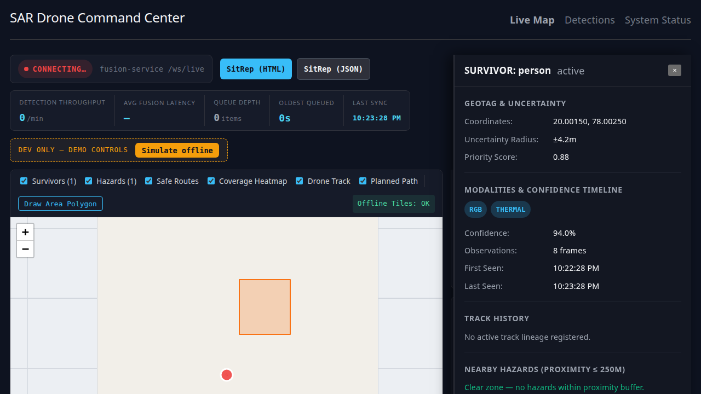
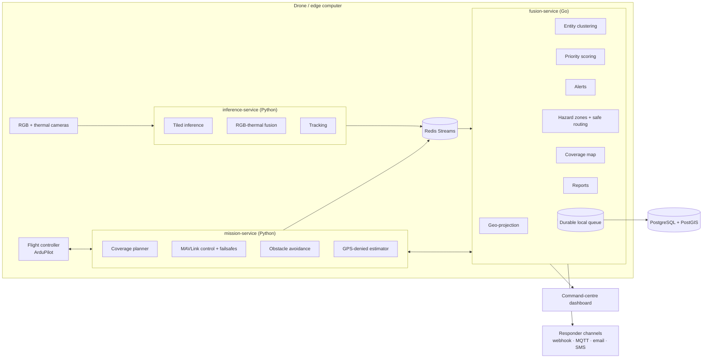
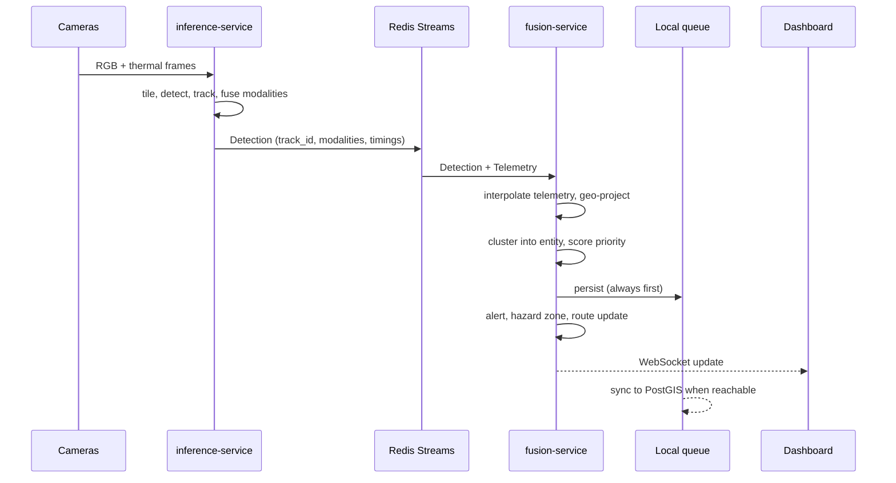
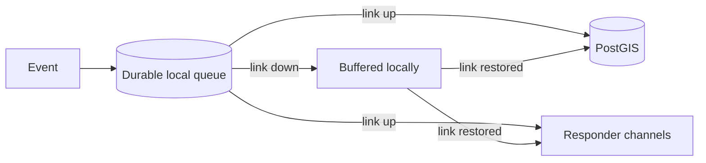

<div align="center">

#  Khoj-o-Drone: Autonomous Search-and-Rescue Intelligence Platform

### On-device AI that finds survivors and hazards, maps them, routes rescuers safely, and keeps working when the network does not

*Smart India Hackathon 2026 · Hardware Track · PS ID SIH26177 · Team NIRIKSH*


[Problem](#the-problem) · [Requirements map](#how-the-problem-statement-is-addressed) · [Architecture](#system-architecture) · [Modules](#modules) · [Dashboard](#dashboard-command-centre) · [Resilience](#offline-resilience) · [Evidence](#evidence-and-reproducibility) · [Quick start](#quick-start) · [Scope](#scope-and-honest-limitations) · [License](#license-and-contributions)

</div>

---

## Command Centre Dashboard



*Command-centre interface featuring multi-pane operational telemetry, live camera feed with RGB/LWIR detection overlays, toggleable vector layers (survivors, hazard zones, safe rescue routes, coverage heatmaps), interactive mission planner, offline store-and-forward indicator, and mission timeline replay.*
*(Captured automatically via Playwright in CI: `make demo-capture`)*

---

## The problem

India's floods, cyclones, earthquakes and landslides leave infrastructure damaged and terrain inaccessible. In the first critical hours, responders need to know **where survivors are, what hazards surround them, and which route is safe**. Ground assessment is slow and dangerous; drones help, but raw video still needs a person to watch it, and disaster zones rarely have dependable connectivity.

Khoj-o-Drone converts drone sensor streams into **decisions** (located survivors, mapped hazards, safe routes, prioritised alerts and written situational reports), computed **locally** so the system keeps working with no network.

## How the problem statement is addressed

| Problem-statement requirement | Where it lives |
|---|---|
| **Autonomous navigation**, GPS-enabled and GPS-denied, obstacle avoidance | `mission-service`: coverage planner, MAVLink control, failsafes, reactive obstacle avoidance, visual-inertial dead-reckoning for GPS loss |
| **On-device AI inference** without the cloud | `inference-service`: ONNX Runtime, INT8 variants, CPU-first edge profile |
| **Multi-sensor fusion** (RGB, thermal, IMU, GPS) | RGB-thermal registration and cross-modal confirmation; attitude-aware geo-projection; EKF-based GPS-denied estimator |
| **Hazard classification** | Hazard models for fire, smoke, flood, debris, damaged structures, landslide and exposed power lines (per-class status in [`docs/CAPABILITIES.md`](docs/CAPABILITIES.md)) |
| **Geo-tagged mapping** with safe routes | `fusion-service` + PostGIS: survivor and hazard entities, buffered hazard zones, A* safe routing, searched-area coverage map |
| **Emergency alerting** and prioritised recommendations | Documented priority formula, hysteresis alerts, ranked rescue recommendations, webhook / MQTT / email / SMS adapters |
| **Offline resilience** | Durable store-and-forward everywhere, idempotent sync, offline map tiles, automated chaos tests |
| **Command-centre dashboard** | React dashboard: live feeds with detections, map layers, mission control, alerts, reports, replay |
| **Situational reports** | Auto-generated JSON and printable HTML report per mission |

Every capability's status and its supporting evidence is tracked in [`docs/CAPABILITIES.md`](docs/CAPABILITIES.md).

---

## System architecture



**Design principle: everything on the left of the database runs offline.** Inference, fusion, scoring, routing, alerting and the local dashboard have no cloud dependency; the database and outbound channels are synchronised when connectivity allows.

### Life of a detection



---

## Modules

###  `inference-service`: on-device perception

- **ONNX Runtime** execution with CPU default and optional CUDA/TensorRT; verified-checksum model loading through a registry.
- **Models:** RGB person detector, thermal person detector, and hazard models. Training, evaluation, INT8 quantisation and model cards for each are in [`training/`](training/) and [`models/`](models/).
- **Tiled inference** with overlap and cross-tile suppression so small, distant people are not lost to downscaling.
- **Tracking** gives each object a stable `track_id`, so one person seen across many frames is one entity, not many detections.
- **RGB-thermal fusion:** detections are registered between sensors with a calibrated homography and confirmed across modalities; thermal-only detections remain valid for people hidden from visible light.
- **Robust by default:** bounded queues with drop counters, per-stage latency metrics at `/metrics`, and honest degraded health (it never invents detections when a model is missing).

###  `fusion-service`: from pixels to decisions

| Capability | How |
|---|---|
| **Geo-projection** | Interpolated telemetry at frame time, full camera model (FOV intrinsics, mounting pitch, drone roll/pitch/yaw, altitude), ray-cast to the ground |
| **Entity clustering** | Detections merge into `Survivor` and `Hazard` entities with running position and uncertainty radius |
| **Priority scoring** | Documented formula ([`docs/PRIORITY.md`](docs/PRIORITY.md)): class severity, confidence, modality agreement, persistence, and proximity of hazards |
| **Alerting** | Thresholds with hysteresis, cooldown, de-duplication, escalation and resolution |
| **Hazard zones** | Polygons with configurable safety buffers, stored in PostGIS |
| **Safe routing** | A* from a staging point to each survivor avoiding buffered hazards; reports explicitly when no safe route exists |
| **Coverage map** | Per-cell observation count, recency and confidence: how sure the system is that an area has been searched |
| **Reports** | Situational report as JSON and printable HTML |
| **APIs** | REST, WebSocket `/ws/live`, OpenAPI spec in [`docs/`](docs/) |

###  `mission-service`: autonomy

- **Coverage planner:** lawnmower paths from an area polygon, camera footprint, altitude and overlap; concave areas are decomposed.
- **Adaptive search:** when the coverage map shows low-confidence cells, or a survivor is found, the plan adapts (confirm by loitering, then resume).
- **MAVLink control** of an ArduPilot flight controller (SITL in this repository): arm, takeoff, mission, return-to-launch, land.
- **Failsafes:** low battery, link loss, geofence breach and GPS loss each have a tested response.
- **Obstacle avoidance:** a reactive vector-field layer adjusts setpoints from range data; validated in simulation.
- **GPS-denied estimation:** optical-flow velocity, IMU and barometer fused with an EKF to hold a position estimate when GPS drops. This is visual-inertial odometry, not full SLAM; see [scope](#scope-and-honest-limitations).

###  `dashboard`: command centre

- Live feeds with detection overlays (RGB and thermal)
- Toggleable map layers: survivors, hazard zones, safe routes, coverage heat-map, drone track, planned path
- Mission control: draw an area, preview the coverage plan, start / pause / resume / abort
- Entity drawer: track history, confidence timeline, uncertainty radius, nearby hazards, routes, acknowledge / resolve
- Connectivity and degraded-mode banner driven by real queue metrics
- **Replay mode** to review a finished mission
- Report download

###  `shared`
Protobuf and JSON Schema contracts for every message, validated in Python, Go and TypeScript by a contract test.

---

## Offline resilience



- **Nothing goes straight to the network.** Database writes, dashboard events, alerts and reports all pass through a durable local queue.
- **At-least-once delivery with idempotency keys,** deterministic conflict resolution and ordered replay on reconnect.
- **Explicit degraded modes:** what keeps running offline (inference, geotagging, scoring, local alerts, local dashboard, cached map tiles) and what pauses (remote delivery) is defined and surfaced in `/health` and the UI.
- **Automated chaos tests** partition the network and stop Postgres or Redis mid-mission, then verify that no detection is lost and ordering is preserved (`make test-chaos`).
- **Edge profile:** `docker-compose.edge.yml` runs inference, fusion and mission under a CPU/RAM cap to represent a companion computer.

---

## Evidence and reproducibility

No number in this README is typed by hand. Everything measurable is produced by one command from raw artefacts:

```bash
make evaluate
```

which regenerates:

| File | Contents |
|---|---|
| [`docs/RESULTS.md`](docs/RESULTS.md) | Per-model accuracy, INT8 deltas, end-to-end latency percentiles, edge-profile throughput and memory, geotag error against simulator ground truth, RGB-vs-thermal-vs-fused comparison, routing safety, coverage, chaos-test outcomes, GPS-denied drift |
| [`docs/CAPABILITIES.md`](docs/CAPABILITIES.md) | Every requirement and hazard class with its status (supported / experimental / not covered) and a pointer to its evidence |

Model cards are in [`models/`](models/), and each file in `models/registry.json` carries a SHA-256 checksum, training dataset and licence. Simulation scenarios in [`scenarios/`](scenarios/) are deterministic: same seed, same telemetry.

---

## Quick start

Requires Docker (Compose v2) and Make. A GPU is not required.

```bash
git clone https://github.com/YusufMalu001/sar-drone-prototype.git
cd sar-drone-prototype

make fetch-assets        # models, demo footage, offline tiles (checksum-verified)
make up                  # build and start the full stack
make demo SCENARIO=flood # run a simulated disaster scenario
```

Open the dashboard at **http://localhost:5173**.

| Command | Purpose |
|---|---|
| `make sitl` | Start ArduPilot SITL |
| `make demo SCENARIO=flood\|fire\|collapse` | Run a scenario (add `MODE=sitl` to fly the planned path in SITL) |
| `make demo-capture` | Headless Playwright run capturing dashboard screenshots and demo video |
| `make test` | Unit and integration tests across Go, Python, and TypeScript |
| `make test-chaos` | Network-partition and outage tests with zero-loss assertions |
| `make evaluate` | Regenerate all results and capability documents from raw artifacts |
| `make evaluate-smoke` | CI smoke verification for artifacts and metric sources |
| `make lint` | Lint all services |
| `make down` | Stop the stack |

Guided walkthrough: [`DEMO.md`](DEMO.md). Architecture and algorithms: [`ARCHITECTURE.md`](ARCHITECTURE.md). API: [`docs/API.md`](docs/API.md). Operations: [`docs/OPERATIONS.md`](docs/OPERATIONS.md). Audit: [`docs/README_AUDIT.md`](docs/README_AUDIT.md).

### Ports

| Service | URL |
|---|---|
| Dashboard | http://localhost:5173 |
| inference-service | http://localhost:8001 (`/health`, `/metrics`) |
| fusion-service | http://localhost:8002 (`/health`, REST, `/ws/live`) |
| mission-service | http://localhost:8003 |
| PostgreSQL / Redis | `5432` / `6379` |

---

## License and Contributions

- **Source Code License:** [Apache 2.0](LICENSE)
- **Contributing Guidelines:** [CONTRIBUTING.md](CONTRIBUTING.md)
- **Code of Conduct:** [CODE_OF_CONDUCT.md](CODE_OF_CONDUCT.md)
- **Dataset, Model & Footage Attributions:** [docs/LICENSES.md](docs/LICENSES.md)

---

## Repository structure

```
sar-drone-prototype/
├── inference-service/    ONNX Runtime inference, tiling, tracking, RGB-thermal fusion
├── fusion-service/       Go: geo-projection, clustering, scoring, alerts, routing, reports
├── mission-service/      Coverage planning, MAVLink control, failsafes, avoidance, GPS-denied
├── dashboard/            React + TypeScript command centre
├── simulator/            Deterministic scenario runner with ground truth
├── scenarios/            Flood, fire and collapse scenarios
├── training/             Model training, evaluation, quantisation
├── models/               Registry, checksums, metrics, model cards
├── shared/               Protobuf + JSON Schema contracts
├── scripts/              Asset fetching and tooling
├── docs/                 RESULTS, CAPABILITIES, PRIORITY, MISSION, API, OPERATIONS
├── docker-compose.yml    Full stack
├── docker-compose.edge.yml  Resource-capped edge profile
├── Makefile
└── DEMO.md  ARCHITECTURE.md
```

---

## Testing strategy

| Level | What is tested |
|---|---|
| Unit | Geo-projection against hand-computed geometries, tracker identity, fusion logic, priority ordering, alert hysteresis, routing, coverage, planner area coverage, avoidance |
| Contract | The same Detection and Telemetry validate in Python, Go and TypeScript |
| Integration | Scenario runs against ground truth; SITL flights and failsafes |
| Chaos | Network, Postgres and Redis outages with zero-loss assertions |
| End-to-end | Playwright runs a scenario and asserts survivors and alerts appear on the dashboard |
| CI | Build, lint, tests and a reduced evaluation on every push |

---

## Scope and honest limitations

- **Hardware is not integrated in this repository.** The flight controller is ArduPilot **SITL**; camera streams are replayed from recorded footage with synchronised, synthesised telemetry. The software is written against the MAVLink and message interfaces a real airframe would use.
- **Thermal and hazard models are trained on public datasets,** which differ from real disaster imagery. Accuracy on real missions will differ; per-class metrics and failure modes are in the model cards.
- **GPS-denied navigation** is implemented as visual-inertial dead-reckoning with a measured drift rate. Full SLAM is not implemented.
- **Obstacle avoidance** is validated in simulation against synthetic obstacle maps only.
- **Chemical-leak detection is not covered:** there is no suitable public dataset, so it is not claimed.
- **Geo-projection** assumes locally flat ground with a configurable terrain offset; accuracy depends on telemetry quality.

## Roadmap

- [ ] Integrate the target airframe (hexacopter, Pixhawk-class flight controller, RGB + thermal payload, Jetson-class companion computer)
- [ ] Replace dead-reckoning with a full visual-inertial SLAM backend
- [ ] Field-validate geotag accuracy against surveyed ground points
- [ ] Fine-tune models on real disaster imagery
- [ ] Multi-drone coordination and shared coverage maps
- [ ] Chemical-hazard sensing with a dedicated payload

## Team NIRIKSH

Six-person multidisciplinary team spanning robotics, automation, IoT, mechanical engineering, AI/data science and computer science.

**Software and perception:** Yusuf Malu Bhai Wala · [GitHub](https://github.com/YusufMalu001)
- `fusion-service/go.mod` has no committed `go.sum` (see note above).
- Alerts generated from a detection drained out of the offline queue use a
  best-effort (not perfectly historical) hazard-proximity context — see
  the doc comment on `fusion-service/internal/fusion`.
