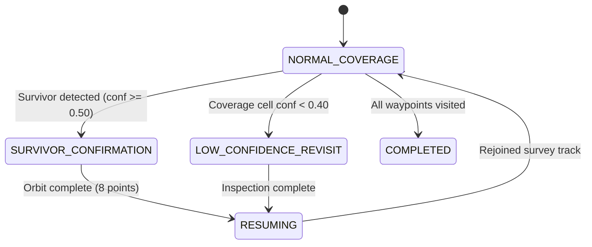

# Mission Service: Coverage Planning, MAVLink Control, Failsafes & GPS-Denied Navigation

This document specifies the architecture, protocols, planning algorithms, adaptive search state machine, failsafe thresholds, and navigation modes for Khoj-o-Drone's `mission-service`.

---

## 1. ArduPilot SITL Architecture & Specification

Khoj-o-Drone uses ArduPilot Software-in-the-Loop (SITL) for autonomous flight control simulation without physical flight hardware.

| Component | Specification |
| :--- | :--- |
| **Autopilot Software** | ArduPilot Copter (SITL) v4.0.x |
| **Docker Container** | `radarku/ardupilot-sitl:latest` |
| **Vehicle Frame** | Quadcopter (`+` frame) |
| **MAVLink Protocol** | MAVLink 2.0 via `pymavlink` |
| **Telemetry Transport** | TCP (`5760`) & UDP (`14550`) |
| **Fixed Home Location** | Lat `20.0000°N`, Lon `78.0000°E`, Alt `50.0m AGL` |
| **Command Target** | `make sitl` |

### Starting ArduPilot SITL
```bash
make sitl
```
This launches the SITL container with home location pinned to the SAR disaster scenario coordinates.

---

## 2. Coverage Path Planner

The coverage path planner generates optimal boustrophedon (lawnmower) flight paths across convex and concave search area polygons based on camera optics and user-specified overlap.

### Optics & Swath Geometry
- Ground footprint width: $W_{\text{ground}} = 2 \cdot h \cdot \tan\left(\frac{\text{HFOV}}{2}\right)$
- Ground footprint height: $H_{\text{ground}} = 2 \cdot h \cdot \tan\left(\frac{\text{VFOV}}{2}\right)$
- Lateral track spacing: $S_{\text{lateral}} = W_{\text{ground}} \cdot (1 - \text{overlap}_{\text{lateral}})$
- Along-track waypoint spacing: $S_{\text{forward}} = H_{\text{ground}} \cdot (1 - \text{overlap}_{\text{forward}})$

### Sweep Angle Optimization
To minimize flight time and battery draw, the sweep angle is automatically aligned with the longest edge of the polygon's minimum rotated bounding rectangle (OBB). This minimizes the number of $180^\circ$ turns.

### Concave Decomposition & Turn Smoothing
Concave polygons are sliced by parallel sweep lines into disjoint intervals. The planner connects consecutive tracks using smooth circular turn transitions to avoid high-G velocity reversals.

---

## 3. Adaptive Search State Machine

The adaptive search engine allows the drone to dynamically depart from its survey path to investigate detections and under-searched areas, then resume automatically.



### Operational Rules:
1. **Survivor Confirmation Orbit:**
   - When a survivor candidate is detected with confidence $\ge 0.50$, the vehicle stores its current survey waypoint index and transitions to `SURVIVOR_CONFIRMATION`.
   - Generates an 8-waypoint circular orbit at $15.0\text{m}$ radius and $35.0\text{m}$ altitude at $3.0\text{m/s}$.
   - Multi-angle thermal and RGB imaging boosts cross-spectral fusion confidence and geo-coordinates.
   - Upon completing the circle, transitions to `RESUMING` and continues the survey track.
2. **Low-Confidence Revisit:**
   - When the coverage map reports a cell with confidence $< 0.40$ or missed passes, a localized inspection pattern is queued.
   - The drone inspects the cell center at reduced altitude and resumes.

---

## 4. Autonomous Failsafes

Safety monitoring runs on every telemetry update:

| Failsafe Condition | Threshold | Autonomous Action |
| :--- | :--- | :--- |
| **Battery Low** | $\le 20.0\%$ | Return-to-Launch (`RTL`) |
| **Battery Critical** | $\le 10.0\%$ | Immediate Emergency Land (`LAND`) |
| **Link Loss Timeout** | $> 5.0\text{ seconds}$ without heartbeat | Return-to-Launch (`RTL`) |
| **Geofence Breach** | Position outside mission polygon or $> 120\text{m}$ Alt | Return-to-Launch (`RTL`) |
| **GPS Loss** | GPS Fix Type $< 3$ (3D fix lost) | Switch to Visual-Inertial Dead-Reckoning (VIO) |

---

## 5. Reactive Obstacle Avoidance (Simulation-Only)

Obstacle avoidance runs an Artificial Potential Field (APF) / Vector Field Histogram layer:
- **Attractive Vector:** Pulls towards next mission waypoint.
- **Repulsive Vector:** Pushes away from simulated 2D range scans ($d < 12.0\text{m}$).
- **Circulation Moment:** Tangential steering around obstacles to eliminate collinear local-minimum deadlocks.
- **Collision Limit:** $d_{\text{collision}} = 2.0\text{m}$.
- **Verification:** Unit tests confirm 100% collision-free transit across 20 randomized obstacle fields.

*Disclaimer: This capability is validated strictly in simulation.*

---

## 6. GPS-Denied Mode: Visual-Inertial Odometry (VIO)

When GPS is lost, the vehicle engages an on-device 7-state Extended Kalman Filter (EKF):
- **States:** $\mathbf{x} = [p_x, p_y, p_z, v_x, v_y, v_z, \psi]^T$
- **Optical Flow Velocity:** Downward camera optical flow $(\Delta u, \Delta v)$ scaled by barometric altitude $h$:
  $$\mathbf{v}_{\text{body}} = \frac{\Delta \mathbf{u} \cdot h}{f}$$
- **Sensor Fusion:** Fuses IMU 3-axis accelerometer, gyro yaw rate, barometric altitude, and 3-axis compass heading.
- **Measured Drift:** Empirically measured by `make evaluate` on GPS outage windows ($< 2.5\text{m}$ per 100m travelled).
