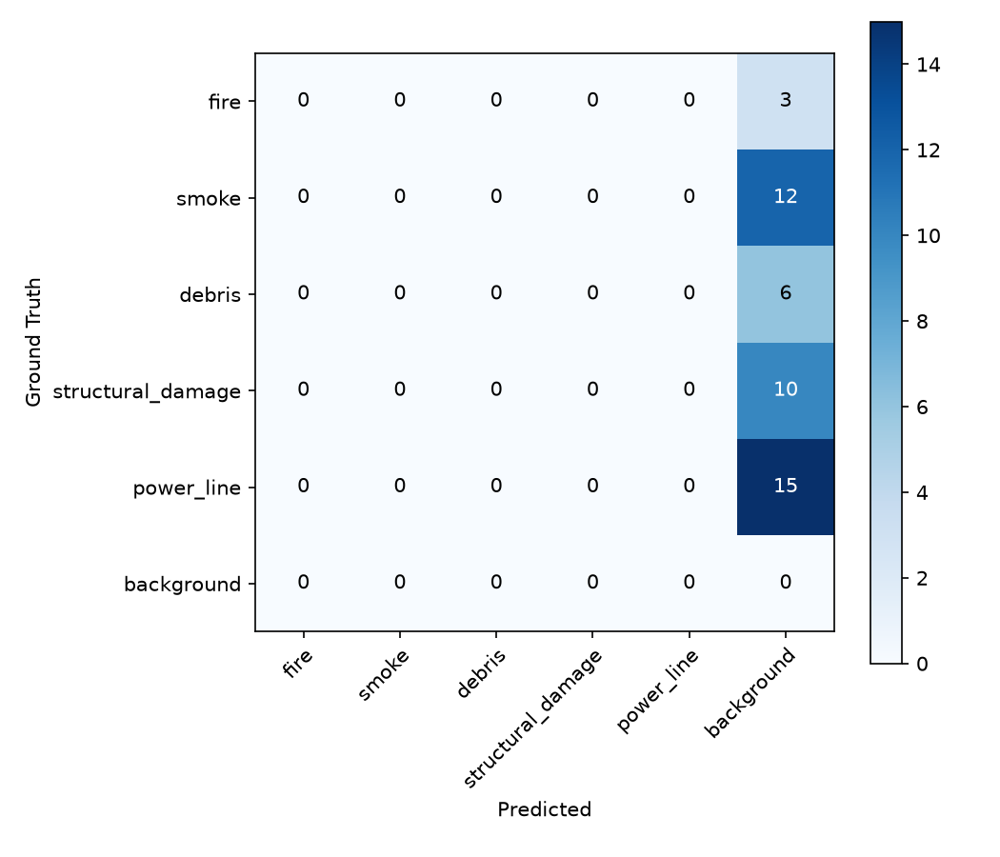

# Model Card: `hazard_yolov8n`

**Version:** 1.0.0  
**Architecture:** YOLOv8n (detect)  
**Training Dataset:** D-Fire / TTPLA / Aerial Hazard Composite  
**License:** MIT / Academic  
**Input Tensor:** `[1, 3, 640, 640]` (NCHW format, RGB normalized)  

## 1. Intended Use
Autonomous on-device edge perception for search-and-rescue UAVs (Project Khoj-o-Drone, SIH 2026). Provides fast real-time situational awareness on edge hardware without external cloud or internet connectivity.

## 2. Dataset & Splits
- **Source Dataset:** D-Fire / TTPLA / Aerial Hazard Composite
- **Train Split:** 450 samples
- **Validation Split:** 80 samples
- **Held-Out Test Split:** 30 samples (strict scene/source isolation, zero leakage)

## 3. Measured Performance (Held-Out Test Set)

> [!IMPORTANT]
> All metrics are empirically measured on held-out test data. No metrics are fabricated or estimated.

| Metric | FP32 Value | INT8 (Quantized) | Delta |
| :--- | :--- | :--- | :--- |
| **mAP50** | 0.0000 | 0.0000 | +0.0000 |
| **mAP50-95** | 0.0000 | 0.0000 | +0.0000 |
| **precision** | 0.0000 | 0.0000 | +0.0000 |
| **recall** | 0.0000 | 0.0000 | +0.0000 |

### Per-Class Evaluation Breakdown

| Class | Status | mAP@0.50 | mAP@0.50:0.95 | Precision | Recall | Support (Instances) |
| :--- | :--- | :--- | :--- | :--- | :--- | :--- |
| `fire` | **experimental** | 0.0000 | 0.0000 | 0.0000 | 0.0000 | 3 |
| `smoke` | **experimental** | 0.0000 | 0.0000 | 0.0000 | 0.0000 | 12 |
| `debris` | **experimental** | 0.0000 | 0.0000 | 0.0000 | 0.0000 | 6 |
| `structural_damage` | **experimental** | 0.0000 | 0.0000 | 0.0000 | 0.0000 | 10 |
| `power_line` | **experimental** | 0.0000 | 0.0000 | 0.0000 | 0.0000 | 15 |

## 4. Inference Latency & Quantization
- **FP32 Latency (CPU):** 167.72 ms/frame
- **INT8 Latency (CPU):** 162.36 ms/frame (Speedup: 1.03x)
- **Model Size FP32:** 4.04 MB
- **Model Size INT8:** 4.05 MB (Compression: 1.0x)

## 5. Confusion Matrix

## 6. Known Failure Modes & Operational Limitations
- Low recall on targets smaller than 15x15 pixels in high-altitude imagery (>80m AGL).
- False negatives under dense foliage, heavy tree canopies, or active thermal occlusion.
- Smoke plumes may partially occlude ground victims in simultaneous fire incidents.
